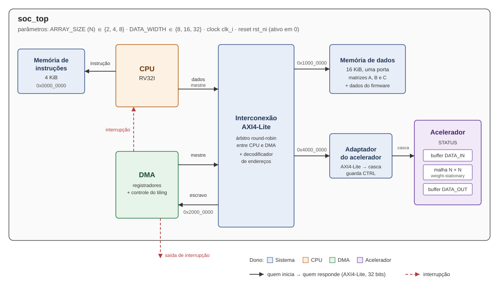

# Especificação do sistema — Entrega 1

Este documento descreve como os blocos do sistema se ligam: o diagrama, o barramento, o mapa de memória, os registradores e os sinais de cada bloco. Ele também é a versão 1.0 do contrato de interfaces: nenhum bloco muda uma porta descrita aqui sem combinar com os donos afetados e registrar a decisão de arquitetura (ADR) em [02.Architecture/decisions/](../02.Architecture/decisions/).

Os termos técnicos estão no [glossário](#glossário), no fim.

## 1. O sistema

O sistema calcula C = A × B, onde A (M × K), B (K × N) e C (M × N) são matrizes de inteiros guardadas na memória de dados.
- A **CPU** RISC-V de 32 bits (RV32I) configura a operação e dá a partida.
- O **DMA** move os dados sozinho e coordena o acelerador.
- O **acelerador** é uma malha de `ARRAY_SIZE` × `ARRAY_SIZE` elementos de processamento (*systolic array*), com `ARRAY_SIZE` = 2, 4 ou 8. No readme do acelerador, o mesmo parâmetro se chama `N`.

O acelerador é do tipo *weight-stationary*: um bloco de B (os "pesos") fica parado dentro da malha enquanto os blocos de A passam por ela. Matrizes maiores que a malha são divididas em blocos de `ARRAY_SIZE` × `ARRAY_SIZE` (*tiling*), e é o DMA quem percorre esses blocos.

**Exemplo do caminho de uma multiplicação.** A ordem dos blocos é decisão do DMA; esta é uma ordem possível.
1. As matrizes A e B já estão na memória de dados. Na simulação, quem as carrega é o testbench.
2. A CPU escreve nos registradores do DMA os endereços de A, B e C e as dimensões M, K e N, e escreve START.
3. Para cada bloco de B, o DMA:
   - copia o bloco da memória para o buffer de entrada do acelerador;
   - manda o acelerador carregar os pesos (LOAD) e espera o fim (DONE).
4. Para cada bloco de A que usa esses pesos, o DMA:
   - copia o bloco para o buffer de entrada e manda calcular (START);
   - espera DONE, lê o buffer de saída e soma o resultado na região de C.
5. Quando todos os blocos terminam, o DMA liga DONE no seu registrador de status e, se habilitada, a interrupção.

Enquanto isso, a CPU só lê o status ou espera a interrupção. Ela não toca nas matrizes.

**Os sinais que o enunciado pede entre DMA e acelerador** viram acessos pelo barramento:

| O que o enunciado chama de | No sistema |
|---|---|
| Requisição | escrita em `CTRL.LOAD` ou `CTRL.START` |
| Pronto/ocupado | `STATUS.STATE`: 0 = parado, 1 = carregando, 2 = calculando |
| Conclusão | `STATUS.DONE` |

## 2. Diagrama de blocos



Fonte editável: [top_level.svg](../02.Architecture/diagrams/top_level.svg). Versão para slides e PDF: [top_level.png](../02.Architecture/diagrams/top_level.png).

| Bloco | Dono | Papel |
|---|---|---|
| CPU | CPU | executa o firmware; mestre do barramento pela porta de dados |
| Memória de instruções | Sistema | guarda o firmware; ligada só à porta de instrução da CPU, fora do barramento |
| Interconexão AXI4-Lite | Sistema | liga os 2 mestres aos 3 escravos; decide quem usa o barramento quando os dois pedem ao mesmo tempo |
| Memória de dados | Sistema | guarda A, B, C e os dados do firmware |
| DMA | DMA | escravo (registradores) e mestre (move os dados e comanda o acelerador) |
| Adaptador do acelerador | Sistema | traduz AXI4-Lite para os sinais simples da casca do acelerador e guarda o registrador CTRL |
| Acelerador | Acelerador | buffers de entrada e saída, malha e máquina de estados própria |

**Portas do `soc_top`**, usadas pelo testbench: `clk_i`, `rst_ni` e `irq_o`, que é a mesma interrupção que o DMA manda para a CPU.

**Parâmetros:**

| Parâmetro | Valores | Usado por |
|---|---|---|
| `ARRAY_SIZE` | 2, 4, 8 | acelerador, DMA e adaptador |
| `DATA_WIDTH` | 8, 16, 32 | acelerador, DMA e adaptador |
| `IMEM_BYTES` | padrão 4 KiB | memória de instruções |
| `DMEM_BYTES` | padrão 16 KiB | memória de dados |

## 3. Barramento AXI4-Lite

Todos os acessos de dados passam por uma interconexão AXI4-Lite.
- **Mestres:** a porta de dados da CPU e o DMA.
- **Escravos:** a memória de dados, os registradores do DMA e o adaptador do acelerador.

**Por que assim.** O acelerador foi especificado como um bloco no barramento. Com isso, uma porta mestre só no DMA alcança a memória e o acelerador. AXI4-Lite é um padrão documentado, igual para todos os blocos, e um único checador de protocolo serve para todas as portas. Os detalhes estão no [ADR 0001](../02.Architecture/decisions/0001-barramento-axi4-lite.md).

**Parâmetros:** endereço de 32 bits, dados de 32 bits, `WSTRB` de 4 bits.

**Clock e reset:**
- um único clock, `clk_i`, para o sistema todo, com borda de subida;
- o reset é `rst_ni`, ativo em nível baixo e assíncrono, o mesmo do acelerador;
- durante o reset, todo mestre mantém os sinais VALID em 0;
- ao sair do reset, todos os registradores voltam a 0 e `irq_o` fica em 0.

**Sinais de uma porta AXI4-Lite** (direções vistas pelo mestre):

| Canal | Sinal | Direção | Largura | Função |
|---|---|---|---|---|
| Endereço de escrita | `awaddr` | saída | 32 | endereço do acesso |
| | `awvalid` / `awready` | saída / entrada | 1 / 1 | handshake do endereço |
| Dados de escrita | `wdata` | saída | 32 | dado |
| | `wstrb` | saída | 4 | quais bytes de `wdata` são escritos |
| | `wvalid` / `wready` | saída / entrada | 1 / 1 | handshake do dado |
| Resposta de escrita | `bresp` | entrada | 2 | resultado da escrita |
| | `bvalid` / `bready` | entrada / saída | 1 / 1 | handshake da resposta |
| Endereço de leitura | `araddr` | saída | 32 | endereço do acesso |
| | `arvalid` / `arready` | saída / entrada | 1 / 1 | handshake do endereço |
| Dados de leitura | `rdata` | entrada | 32 | dado lido |
| | `rresp` | entrada | 2 | resultado da leitura |
| | `rvalid` / `rready` | entrada / saída | 1 / 1 | handshake do dado |

Os sinais `awprot`/`arprot` não são usados e ficam em 0. Num escravo, as direções se invertem. Nos nomes de porta, o prefixo indica o papel: `m_axi_` para mestre e `s_axi_` para escravo, como em `m_axi_awaddr`.

**Regras de handshake** (as do padrão AXI):
- uma transferência acontece no ciclo em que VALID e READY estão em 1;
- quem levanta VALID não pode esperar READY para isso, e mantém VALID e os dados estáveis até a transferência;
- READY pode depender de VALID;
- o endereço (AW) e o dado (W) de uma escrita podem chegar em qualquer ordem ou juntos, e o escravo aceita os dois;
- cada mestre faz uma transação por vez, leitura ou escrita: espera a resposta antes de começar a próxima.

**Bytes dentro da palavra (little-endian).**
- O endereço de um acesso é alinhado ao tamanho do dado: palavra em múltiplo de 4, meia palavra em múltiplo de 2.
- O byte do endereço `addr` viaja na faixa `addr[1:0]` de `wdata`/`rdata`. Por exemplo, um byte em `addr[1:0]` = 2 vai em `wdata[23:16]`, com `wstrb` = `0100`.
- Numa leitura, o escravo devolve a palavra inteira, e quem pediu escolhe a faixa.

**Respostas:**

| `bresp`/`rresp` | Nome | Quando |
|---|---|---|
| `00` | OKAY | acesso aceito |
| `10` | SLVERR | o escravo recusou: registrador somente-leitura escrito, offset sem registrador, leitura de DATA_IN etc. |
| `11` | DECERR | nenhum escravo no endereço; a interconexão responde sozinha |

A CPU pode ignorar SLVERR e DECERR. O que o DMA faz com elas está em "Registradores do DMA".

**Disputa entre mestres (round-robin).**
- Quando a CPU e o DMA pedem o barramento ao mesmo tempo, o árbitro dá a vez ao que não foi atendido por último.
- Uma transação começada vai até a resposta antes de o outro mestre entrar.
- Ao fim de cada transação, se o outro mestre está esperando, ele é o próximo. Assim nenhum mestre fica parado para sempre.

## 4. Mapa de memória

| Endereço-base | Região | Tamanho | Quem acessa |
|---|---|---|---|
| `0x0000_0000` | Memória de instruções | 4 KiB | só a porta de instrução da CPU |
| `0x1000_0000` | Memória de dados | 16 KiB | CPU e DMA, pelo barramento |
| `0x2000_0000` | Registradores do DMA | 4 KiB | CPU, pelo barramento |
| `0x4000_0000` | Acelerador (CTRL, STATUS, DATA_IN, DATA_OUT) | 64 KiB | DMA (e a CPU, para diagnóstico), pelo barramento |

Qualquer outro endereço recebe DECERR.

**Regiões padrão das matrizes** na memória de dados:

| Endereço | Conteúdo | Tamanho |
|---|---|---|
| `0x1000_0000` | dados, constantes e pilha do firmware | 4 KiB |
| `0x1000_1000` | matriz A | 4 KiB |
| `0x1000_2000` | matriz B | 4 KiB |
| `0x1000_3000` | matriz C | 4 KiB |

São só valores padrão: o firmware pode pôr as matrizes em outro lugar da memória de dados, porque os endereços vão nos registradores do DMA.

**Carga inicial:** o testbench carrega antes do reset:
- o programa, na memória de instruções;
- a imagem inicial da memória de dados: constantes e variáveis do firmware, A e B.

**Organização das matrizes** (provisória: depende do formato dos números, que o acelerador ainda vai confirmar):
- linha por linha, sem espaço entre as linhas;
- A e B com `DATA_WIDTH / 8` bytes por elemento;
- C com 4 bytes (32 bits) por elemento.

Com 4 KiB por matriz, cabe até 32 × 32 com elementos de 32 bits.

## 5. Registradores do DMA (base `0x2000_0000`)

Os nomes vêm da proposta do dono do DMA. Os endereços estão definidos aqui. Todos voltam a 0 no reset.

| Offset | Nome | Acesso | Conteúdo |
|---|---|---|---|
| `0x00` | `ADDR_A` | leitura e escrita | endereço inicial de A |
| `0x04` | `ADDR_B` | leitura e escrita | endereço inicial de B |
| `0x08` | `ADDR_C` | leitura e escrita | endereço inicial de C |
| `0x0C` | `DIM_M` | leitura e escrita | número de linhas de A e de C |
| `0x10` | `DIM_K` | leitura e escrita | colunas de A = linhas de B |
| `0x14` | `DIM_N` | leitura e escrita | número de colunas de B e de C |
| `0x18` | `CONTROL` | leitura e escrita | bit 0 `START`: escrever 1 dispara a operação, e a leitura dá sempre 0. Bit 1 `IRQ_EN`: habilita a interrupção |
| `0x1C` | `STATUS` | só leitura | bit 0 `BUSY`: operação em andamento. Bit 1 `DONE`: a última operação terminou. Bit 2 `ERROR`: a última operação terminou com erro |

**Dimensões.**
- M, K e N podem ter qualquer valor de 1 até o que cabe na região de cada matriz. Não precisam ser múltiplos de `ARRAY_SIZE`.
- Nos blocos da borda, as posições do buffer que sobram precisam valer 0, para não somar lixo de um bloco anterior. Proposta: o DMA escreve os zeros. Confirmar com o acelerador se ele próprio pode ignorar as posições que sobram.

**Regras de escrita.**
- Os registradores de configuração são `ADDR_*` e `DIM_*`. Escrevê-los com `BUSY` em 1 recebe SLVERR.
- `CONTROL` pode ser escrito a qualquer momento. Toda escrita atualiza `IRQ_EN`.
- `START` com `BUSY` em 1 é ignorado e recebe OKAY.
- `START` aceito liga `BUSY` e limpa `DONE` e `ERROR`.

**Fim e erros.**
- `DONE` só sobe depois que o DMA recebe a resposta (`bresp`) da última escrita de C.
- Dimensão igual a 0 faz o DMA terminar logo, com `DONE` e `ERROR` em 1.
- O DMA para e termina com `DONE` e `ERROR` em 1 se:
  - receber SLVERR ou DECERR num acesso dele, por exemplo um `ADDR_C` fora da memória;
  - o acelerador indicar `STATUS.ERROR`.

**Interrupção.**
- A saída `irq_o` é `DONE` e `IRQ_EN`.
- Ela fica em 1 enquanto as duas condições valem, e cai quando a CPU escreve `START` de novo ou zera `IRQ_EN`.

Bits não listados são lidos como 0.

## 6. Registradores do acelerador (base `0x4000_0000`)

Definidos pelo dono do acelerador. A especificação completa está em [04.RTL/accel/readme.md](../04.RTL/accel/readme.md). Resumo:

| Offset | Nome | Acesso | Conteúdo |
|---|---|---|---|
| `0x0000` | `CTRL` | leitura e escrita | bit 0 `MODE`: 0 = carregar pesos, 1 = calcular. Bits 1 `LOAD`, 2 `START` e 3 `CLR_ERROR`: escrever 1 gera um pulso |
| `0x0004` | `STATUS` | só leitura | bits 1:0 `STATE`: 0 = parado, 1 = carregando, 2 = calculando. Bit 2 `DONE`. Bit 3 `ERROR` |
| `0x1000` | `DATA_IN` | só escrita | buffer de entrada: `ARRAY_SIZE`² elementos, um a cada `DATA_WIDTH / 8` bytes |
| `0x2000` | `DATA_OUT` | só leitura | buffer de saída: `ARRAY_SIZE`² elementos, um a cada `DATA_WIDTH / 8` bytes |

Quem guarda `CTRL` e gera os pulsos é o adaptador do Sistema. Numa mesma escrita em `CTRL`, o novo `MODE` vale no mesmo ciclo do pulso. `STATUS` vem direto do acelerador. Acesso a um offset de buffer além de `ARRAY_SIZE`² elementos recebe SLVERR.

## 7. Sinais de cada bloco

As direções são vistas pelo próprio bloco. Toda porta AXI4-Lite tem os sinais listados em "Barramento AXI4-Lite".

### CPU

| Porta | Direção | Largura | Função |
|---|---|---|---|
| `clk_i`, `rst_ni` | entrada | 1 | clock e reset |
| `imem_addr_o` | saída | 32 | endereço da instrução |
| `imem_rdata_i` | entrada | 32 | instrução lida, disponível no mesmo ciclo do endereço |
| `m_axi_*` | mestre AXI4-Lite | — | porta de dados (`lw`, `sw`, `lb`, `sb` etc.). Byte e meia palavra usam `wstrb` e a faixa `addr[1:0]` |
| `irq_i` | entrada | 1 | interrupção de fim do DMA (uso opcional) |

### DMA

| Porta | Direção | Largura | Função |
|---|---|---|---|
| `clk_i`, `rst_ni` | entrada | 1 | clock e reset |
| `s_axi_*` | escravo AXI4-Lite | — | os registradores listados em "Registradores do DMA" |
| `m_axi_*` | mestre AXI4-Lite | — | lê A e B, grava C e comanda o acelerador |
| `irq_o` | saída | 1 | interrupção de fim |

### Adaptador ↔ casca do acelerador

O adaptador (Sistema) recebe os acessos AXI4-Lite à região do acelerador e conversa com a casca pelos sinais abaixo. As direções são vistas pela casca.
- Os sinais de controle vêm do readme do acelerador. Lá, `start` e `load` aparecem sem o sufixo `_i`; aqui recebem o sufixo, como os demais.
- Os marcados como **proposta** faltam no readme e precisam ser confirmados com o dono.

| Sinal | Direção | Largura | Função |
|---|---|---|---|
| `clk_i`, `rst_ni` | entrada | 1 | clock e reset |
| `mode_i` | entrada | 1 | valor de `CTRL.MODE` |
| `load_i` | entrada | 1 | pulso de um ciclo ao escrever `CTRL.LOAD` = 1 |
| `start_i` | entrada | 1 | pulso de um ciclo ao escrever `CTRL.START` = 1 |
| `clr_error_i` | entrada | 1 | pulso de um ciclo ao escrever `CTRL.CLR_ERROR` = 1 |
| `status_o` | saída | 32 | conteúdo de `STATUS` |
| `data_req_i` | entrada | 1 | **proposta:** pedido de acesso a um buffer |
| `data_we_i` | entrada | 1 | **proposta:** 1 = escrita em `DATA_IN`, 0 = leitura de `DATA_OUT` |
| `data_addr_i` | entrada | 16 | **proposta de largura:** offset dentro da região do acelerador (`0x1000`… ou `0x2000`…) |
| `wdata_i` | entrada | 32 | dado de escrita; o elemento vem na faixa de bytes do seu endereço |
| `rdata_o` | saída | 32 | dado de leitura; o elemento vai na faixa de bytes do seu endereço |
| `ready_o` | saída | 1 | o acesso pedido terminou |
| `error_o` | saída | 1 | o acesso era inválido. O adaptador responde SLVERR |

**Regras do pedido** (proposta, cada uma vira uma assertion):
- o adaptador levanta `data_req_i` com `data_we_i`, `data_addr_i` e `wdata_i` e os mantém estáveis até `ready_o`;
- `ready_o` é um pulso de um ciclo, pelo menos um ciclo depois de `data_req_i` subir; não há tempo máximo, e o adaptador espera;
- `rdata_o` e `error_o` valem no ciclo de `ready_o`;
- no ciclo seguinte a `ready_o`, o adaptador baixa `data_req_i` ou começa outro pedido;
- escrever em `DATA_IN` com o acelerador carregando ou calculando é um erro (`error_o` = 1).

### Memórias

| Memória | Interface |
|---|---|
| Dados | escravo AXI4-Lite. Escrita por byte via `wstrb`. Responde em pelo menos 1 ciclo; a latência exata é interna da memória, e o handshake absorve |
| Instruções | `addr_i` (32) e `rdata_o` (32), leitura no mesmo ciclo. Carregada pelo testbench |

## 8. O que muda para cada bloco e o que falta combinar

| Bloco | O quê | Até quando |
|---|---|---|
| Acelerador | Confirmar `data_req_i`, `data_we_i` e a largura de `data_addr_i` | 07/11 (portas congeladas) |
| Acelerador | Formato dos números: `DATA_WIDTH` e se têm sinal | 03/11 (vetores de teste do golden model) |
| Acelerador | **Ordem dos elementos nos buffers:** qual elemento de cada bloco (pesos B, entradas A, saída C) fica em cada posição de `DATA_IN` e `DATA_OUT`. O DMA depende disso para copiar os blocos | 07/11 |
| Acelerador | **Largura dos resultados:** o buffer de saída tem a largura dos operandos, mas a soma dos produtos precisa de mais bits. Proposta: `DATA_OUT` com 32 bits por elemento | 07/11 |
| Acelerador | Se aceita uma escrita de 32 bits com vários elementos de uma vez quando `DATA_WIDTH` < 32 (corta o tráfego de A e B) | 07/11 |
| DMA e acelerador | **Onde somar os resultados parciais e em que ordem percorrer os blocos** (uma decisão só, explicada logo após a tabela) | 07/11 |
| DMA | Trocar as interfaces de memória e de acelerador da proposta inicial por uma porta mestre AXI4-Lite. O DMA comanda o acelerador escrevendo `CTRL` e lendo `STATUS` | 07/11 (portas congeladas) |
| CPU | Com AXI4-Lite, cada `lw`/`sw` leva no mínimo dois ciclos, então o core precisa parar até `bvalid`/`rvalid`. O core single-cycle do laboratório 20 não sabe parar e tem as memórias dentro dele; as duas coisas precisam mudar | 07/11 (portas); 24/11 (core) |
| CPU | Firmware: código na memória de instruções; dados, constantes e pilha em `0x1000_0000` | 25/11 |
| Sistema | Síntese do sistema com memórias de profundidade parametrizada. Sem isso, os cerca de 160 mil flip-flops das memórias escondem a diferença entre as malhas | antes da síntese final |

**Somas parciais e ordem dos blocos.** Cada bloco de C é a soma dos produtos de vários blocos ao longo de K, mas o buffer de saída guarda um bloco só. Há duas saídas:
- **somar no DMA:** a cada bloco calculado, o DMA lê C, soma e grava de volta. Funciona com qualquer ordem, inclusive a do exemplo do início deste documento, mas multiplica o tráfego de C no barramento;
- **somar no acelerador**, que acumula entre um START e outro: o DMA precisa terminar todos os blocos de K de um mesmo bloco de C antes de passar ao próximo, e os pesos são recarregados com mais frequência.

**Polling.** Quando a CPU lê o `STATUS` do DMA em laço, ela disputa o barramento com o DMA. O round-robin garante que nenhum dos dois fica parado para sempre, mas o DMA perde parte dos ciclos. A interrupção evita isso.

## 9. Golden model

O modelo de referência fica em [03.Reference/](../03.Reference/). É Python só com a biblioteca padrão e roda no Python 3.9 da WSL do curso. Ele calcula o resultado esperado de C = A × B de duas formas:
- **direta**, para servir de referência;
- **por blocos**, com o mesmo recorte que o hardware faz.

**Parâmetros:**
- tamanho dos blocos, inclusive não quadrados;
- ordem em que os blocos são percorridos. O padrão mantém um bloco de B fixo enquanto os blocos de A passam, como no weight-stationary;
- largura dos operandos: 8, 16 ou 32 bits, com ou sem sinal;
- largura do acumulador, com estouro que dá a volta como no hardware.

Matrizes de teste são geradas por seed: aleatórias, zeros, máximos, mínimos e identidade.

**Os testes conferem:**
- que cada produto cai em exatamente um bloco;
- que a sequência de blocos de cada ordem está certa;
- que o resultado por blocos é igual ao direto, para malhas 2, 4 e 8, matrizes múltiplas e não múltiplas do tamanho da malha e os formatos acima.

```bash
make test                       # WSL, Python 3.9
python -m pytest 03.Reference   # Windows
```

## Glossário

| Termo | Significado |
|---|---|
| RV32I | conjunto básico de instruções inteiras do RISC-V de 32 bits |
| AXI4-Lite | protocolo de barramento da ARM para acessos simples de 32 bits, com canais separados para endereço, dado e resposta |
| Mestre, escravo | quem inicia o acesso (CPU, DMA) e quem responde (memória, registradores) |
| Handshake | troca VALID/READY que marca o ciclo em que uma informação passa de um lado para o outro |
| Árbitro round-robin | escolhe qual mestre usa o barramento, alternando entre eles quando os dois pedem |
| Little-endian | o byte de menor endereço fica nos bits menos significativos da palavra |
| DMA | controlador que move dados entre a memória e o acelerador sem a CPU |
| Systolic array, malha | grade de elementos de processamento. Os dados passam de um elemento para o vizinho a cada ciclo |
| Weight-stationary | um bloco de B (pesos) fica parado na malha enquanto os blocos de A passam |
| Tiling, bloco | divisão das matrizes em pedaços que cabem na malha |
| Casca | parte do acelerador em volta da malha: buffers, contadores e máquina de estados |
| ADR | registro de uma decisão de arquitetura: contexto, alternativas, decisão e consequências |
| Golden model | modelo de referência em software que calcula o resultado esperado |
| Polling | a CPU lê o registrador de status em laço até o bit de fim ligar |
